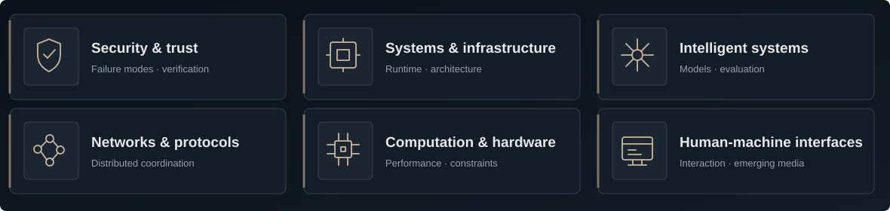
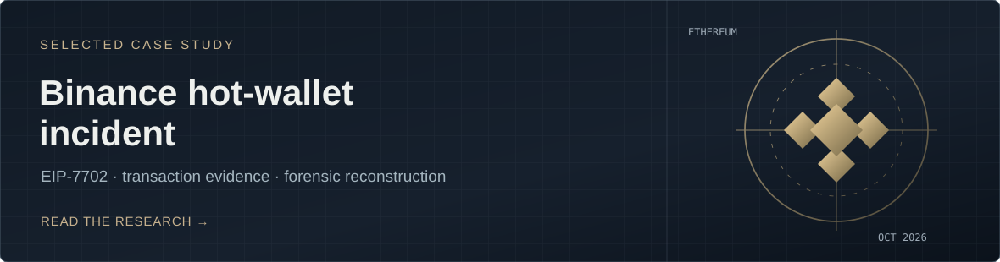

  

 

### Where disciplines intersect

I explore technical problems across system boundaries—from security and infrastructure to computation, intelligent systems, and emerging interfaces. I’m interested in how systems behave, where their assumptions fail, and what can be established through careful experimentation.

Rather than listing tools, this profile is organized around the questions, systems, and investigations I spend time on.

 

### Areas of inquiry

 

### Selected work

This case study examines the **October 2026 Binance hot-wallet incident** through published transaction records and attributed research. It separates observations from interpretations and documents the limits of what public evidence can establish.

[Read the interactive case study](https://am3rix.github.io/binance-hot-wallet-incident-2026/) · [Examine the repository](https://github.com/am3rix/binance-hot-wallet-incident-2026) · [Review the evidence](https://github.com/am3rix/binance-hot-wallet-incident-2026/blob/main/docs/02-evidence-ledger.md)

 

### Research practice

I prefer primary sources, explicit assumptions, small reproducible experiments, and conclusions that hold up to independent scrutiny.

 

### Explore

<a href="https://github.com/am3rix?tab=repositories">Repositories</a> &nbsp;&nbsp;·&nbsp;&nbsp; <a href="https://am3rix.github.io/binance-hot-wallet-incident-2026/">Published research</a> &nbsp;&nbsp;·&nbsp;&nbsp; <a href="https://github.com/am3rix/binance-hot-wallet-incident-2026/issues">Discuss the investigation</a>

